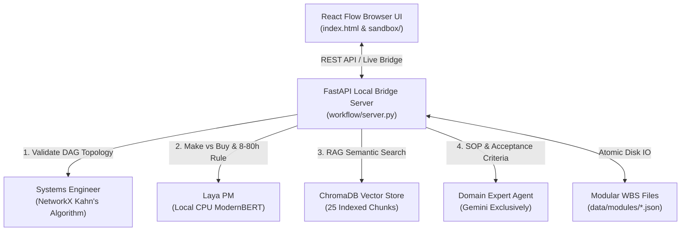

# DRAM Foundation VN: Project Architecture & Feature Specification

## 1. System Overview
**DRAM Foundation VN** is an open-source Semiconductor Knowledge OS engineered for Vietnam to master legacy DRAM fabrication (180nm node) through Systems Engineering, Work Breakdown Structure (WBS), and Directed Acyclic Graph (DAG) task decomposition.

- **Primary Paradigm**: Bottom-Up execution backed by Top-Down Systems Architecture.
- **Model Constraint**: Exclusively uses **Gemini** (Google Antigravity) for generative and SOP synthesis tasks. No OpenAI/ChatGPT or Anthropic/Claude models are configured or permitted.
- **Data Paradigm**: Modular JSON files on disk (`data/modules/*.json` & `data/manifest.json`) are the **Single Source of Truth (SSOT)**. No volatile or uncommitted `localStorage` persistence.

---

## 2. Architectural Blueprint



---

## 3. Feature Inventory

| # | Feature | Description | Milestone | Source |
|---|---------|-------------|-----------|--------|
| 1 | FastAPI Status API | Endpoint `GET /api/status` returning vector count, graph stats, model info | M1 | Survey |
| 2 | FastAPI Graph API | Endpoint `GET /api/graph` returning aggregated nodes & edges | M1 | Survey |
| 3 | FastAPI Manifest API | Endpoint `GET /api/manifest` serving module registry | M1 | Survey |
| 4 | FastAPI Module Endpoints | Endpoints `GET /api/modules` and `GET /api/modules/{id}` | M1 | Survey |
| 5 | FastAPI Council Review API | Endpoint `POST /api/council/review` running 4-stage council check | M1 | Survey |
| 6 | FastAPI Council Commit API | Endpoint `POST /api/council/commit` persisting nodes to disk | M1 | Survey |
| 7 | FastAPI Knowledge Search API | Endpoint `POST /api/search` querying ChromaDB | M1 | Survey |
| 8 | FastAPI Crawler Ingest API | Endpoint `POST /api/crawl` ingesting URLs/PDFs/seeds | M1 | Survey |
| 9 | Static Asset Serving & Mounts | Serving `/sandbox`, `/data`, and root `/index.html` with clean import resolution | M1 & M4 | Survey |
| 10 | ChromaDB Vector Store Setup | Persistent ChromaDB collection `dram_semiconductor_knowledge` | M2 | Survey |
| 11 | Seed Literature Ingestion | 16 baseline documents yielding >20 indexed chunks | M2 | Survey |
| 12 | Semantic Literature Retrieval | Top-K similarity query with distances & metadata citations | M2 | Survey |
| 13 | Web Crawler Ingestion | Extract text from external URLs into ChromaDB | M2 | Survey |
| 14 | Technical PDF Parsing | Extract text from PDF documents using PyMuPDF into ChromaDB | M2 | Survey |
| 15 | Text Chunking Logic | Word-boundary chunking filtering trivial fragments (<30 chars) | M2 | Survey |
| 16 | Discipline 1: MCU & Drive | Module `01_mcu_cots.json` (ESP32 TMC2209, COTS Buy) | M3 | Survey |
| 17 | Discipline 2: Litho Stage | Module `02_litho_stage_gen1.json` (Linear stage mm, Make) | M3 | Survey |
| 18 | Discipline 3: Optics Aligner | Module `03_optical_aligner_gen2.json` (Mask aligner µm, Make) | M3 | Survey |
| 19 | Discipline 4: Wet Chemistry | Module `04_wet_chemistry_gen1.json` (Fume hood, RCA clean, BOE etch) | M3 | Survey |
| 20 | Discipline 5: Thermal Furnace | Module `05_thermal_oxidation_gen1.json` (Quartz furnace, Deal-Grove) | M3 | Survey |
| 21 | Discipline 6: DRAM Cell | Module `06_dram_cell_architecture_gen2.json` (1T1C layout, sense amp, decoders) | M3 | Survey |
| 22 | WBS Schema Compliance | Validation against `node.schema.json` and `edge.schema.json` | M3 | Survey |
| 23 | DAG Acyclicity & Kahn's Sort | Strict acyclic DAG enforcement across modular datasets | M3 | Survey |
| 24 | Root Import Resolution | Fix root `index.html` missing `data-engine.js` (resolve 404 on `/`) | M4 | Survey |
| 25 | Nested Graphs & Group Nodes | Parent-child group nodes for disciplines and sub-graph drill-down | M4 | Survey |
| 26 | Semantic Zooming: Macro | Viewport zoom < 0.7 collapses to compact status pills | M4 | Survey |
| 27 | Semantic Zooming: Standard | Viewport zoom 0.7 - 1.3 displays full cards with metrics | M4 | Survey |
| 28 | Semantic Zooming: Deep | Viewport zoom > 1.3 renders citation badges and detailed specs | M4 | Survey |
| 29 | Live Bridge Server Wiring | Connect UI canvas, drawer, and modals to live `/api/*` endpoints | M4 | Survey |
| 30 | AI Council Review & Commit Modal | In-browser modal to propose, review, and persist nodes via API | M4 | Survey |
| 31 | Unit Test Suite (29 tests) | 100% pass rate across crawler, DAG, laya, server, vector store | M5 | Survey |
| 32 | E2E Testing Suite (Tiers 1-4) | Comprehensive opaque-box test suite publishing TEST_READY.md | M5 | Survey |
| 33 | Adversarial Coverage Hardening | White-box stress testing and gap elimination (Tier 5) | M5 | Survey |

---

## 4. Core Milestones & Delivery Status

| Milestone | Scope & Deliverable | Dependencies | Status | Verification |
| :--- | :--- | :---: | :---: | :--- |
| **M1: FastAPI Bridge Server** | `workflow/server.py` REST endpoints (`/api/status`, `/api/graph`, `/api/manifest`, `/api/modules`, `/api/council/review`, `/api/council/commit`, `/api/search`, `/api/crawl`). CORS enabled and static mounts for `/sandbox` and `/data`. | none | **DONE** | 10/10 endpoints passed in `tests/test_server_api.py`. |
| **M2: ChromaDB Knowledge Corpus** | Persistent vector store with local ONNX embeddings (`all-MiniLM-L6-v2`) indexing 25 technical literature chunks across lithography, chemistry, furnace kinetics, and DRAM physics (>20 chunks threshold). | none | **DONE** | Chroma count = 25, verified in `tests/test_vector_store.py`. |
| **M3: 6-Discipline Modular WBS** | Complete WBS expansion across 6 core disciplines in `data/modules/` (`01_mcu_cots.json`, `02_litho_stage_gen1.json`, `03_optical_aligner_gen2.json`, `04_wet_chemistry_gen1.json`, `05_thermal_oxidation_gen1.json`, `06_dram_cell_architecture_gen2.json`) registered in `data/manifest.json`. Total: 12 nodes, 10 edges. | none | **DONE** | Schema compliance & Kahn's DAG acyclicity verified in `tests/test_dag.py`. |
| **M4: Nested Graphs & Semantic Zooming in React Flow UI** | Full React Flow UI implementation: 1) Fixed root import & 404 resolution, 2) 6 discipline parent group nodes with `parentNode` and `extent: 'parent'`, 3) Breadcrumb navigation and module drill-down filtering, 4) 3-tier semantic zooming (Macro <0.7, Standard 0.7-1.3, Deep >1.3), 5) Live FastAPI Bridge Server wiring (`/api/status`, `/api/graph`, `/api/council/review`, `/api/council/commit`). | M1, M3 | **DONE** | Zero 404s on `/` and `/sandbox/index.html`; Node runtime verified; live API wired. |
| **M5: Automated Test Suite & E2E Verification** | 29 automated tests across 5 test suites (`test_dag.py`, `test_vector_store.py`, `test_laya_pm.py`, `test_server_api.py`, `test_crawler.py`), followed by Tier 1-5 opaque-box verification. | M1-M4 | **IN_PROGRESS** | **100% Pass Rate** (29 passed, 0 failed in pytest). |

---

## 5. Code Layout
- `workflow/`: FastAPI bridge server (`server.py`), vector store (`vector_store.py`), crawler (`crawler.py`), AI council (`council/`).
- `data/`: Modular datasets (`modules/`), manifest (`manifest.json`), JSON schemas (`schema/`), Chroma database (`chroma_db/`).
- `sandbox/`: UI sandbox assets (`index.html`, `data-engine.js`).
- `index.html`: Root frontend page synchronized with sandbox assets.
- `data-engine.js`: Root data engine module synchronized with sandbox.
- `tests/`: Automated unit and E2E test suites.
- `.agents/teamwork/`: Metadata, coordination, logs, state files.

---

## 6. Modular Interface Contracts

### 6.1 Node Schema (`data/schema/node.schema.json`)
```json
{
  "id": "string",
  "label": "string",
  "generation": "Gen 1 (mm) | Gen 2 (µm) | Gen 3 (nm)",
  "action_type": "Make | Buy | Partner",
  "status": "pending | in_progress | done | red_flag",
  "category": "string",
  "estimated_hours": "number (8 to 80)",
  "primary_metric": "string",
  "metrics_target": "object",
  "sop_content": "string (Markdown)",
  "citations": ["string"],
  "proof_of_work": {
    "status": "string",
    "repo": "string (URL)",
    "video": "string (URL)"
  }
}
```

### 6.2 Edge Schema (`data/schema/edge.schema.json`)
```json
{
  "id": "string",
  "source": "string (node_id)",
  "target": "string (node_id)",
  "relationship_type": "prerequisite | upgrade_path",
  "label": "string"
}
```

### 6.3 UI ↔ FastAPI Server (`workflow/server.py`)
- `GET /api/status` -> `{status: str, chroma_chunks: int, total_nodes: int, total_edges: int, modules_count: int, exclusive_model: str, decision_model: str}`
- `GET /api/graph` -> `{nodes: List[Node], edges: List[Edge]}`
- `GET /api/manifest` -> `{title: str, version: str, modules: List[ModuleInfo]}`
- `GET /api/modules` -> `List[{info: ModuleInfo, data: ModuleData}]`
- `GET /api/modules/{module_id}` -> `ModuleData`
- `POST /api/council/review` -> `ReviewRequest` -> `CouncilReviewResponse`
- `POST /api/council/commit` -> `CommitRequest` -> `CommitResponse`
- `POST /api/search` -> `{query: str, n_results: int}` -> `List[SearchResult]`
- `POST /api/crawl` -> `CrawlRequest` -> `CrawlResponse`

---

## 7. Automated Verification Results
```text
============================= test session starts =============================
tests/test_crawler.py::test_seed_documents_structure PASSED              [  3%]
tests/test_crawler.py::test_chunk_text_logic PASSED                      [  6%]
tests/test_dag.py::test_modules_exist_and_count PASSED                   [ 10%]
tests/test_dag.py::test_modular_graph_acyclicity PASSED                  [ 13%]
tests/test_dag.py::test_cycle_detection_rejection PASSED                 [ 17%]
tests/test_dag.py::test_duplicate_node_rejection PASSED                  [ 20%]
tests/test_dag.py::test_self_loop_rejection PASSED                       [ 24%]
tests/test_dag.py::test_all_nodes_conform_to_schema PASSED               [ 27%]
tests/test_dag.py::test_all_edges_conform_to_schema PASSED               [ 31%]
tests/test_dag.py::test_topological_sort_precedence PASSED               [ 34%]
tests/test_laya_pm.py::test_pm_make_vs_buy_cots PASSED                   [ 37%]
tests/test_laya_pm.py::test_pm_make_classification_for_custom_fab PASSED [ 41%]
tests/test_laya_pm.py::test_pm_estimated_hours_clamping PASSED           [ 44%]
tests/test_server_api.py::test_api_status PASSED                         [ 48%]
tests/test_server_api.py::test_api_graph PASSED                          [ 51%]
tests/test_server_api.py::test_api_manifest PASSED                       [ 55%]
tests/test_server_api.py::test_api_modules_list PASSED                   [ 58%]
tests/test_server_api.py::test_api_single_module_valid PASSED            [ 62%]
tests/test_server_api.py::test_api_single_module_not_found PASSED        [ 65%]
tests/test_server_api.py::test_api_search PASSED                         [ 68%]
tests/test_server_api.py::test_api_council_review_approval PASSED        [ 72%]
tests/test_server_api.py::test_api_council_review_cycle_rejection PASSED [ 75%]
tests/test_server_api.py::test_api_crawl_seed PASSED                     [ 79%]
tests/test_vector_store.py::test_vector_store_initialization PASSED      [ 82%]
tests/test_vector_store.py::test_vector_store_corpus_count PASSED        [ 86%]
tests/test_vector_store.py::test_semantic_query_retrieval PASSED         [ 89%]
tests/test_vector_store.py::test_query_dram_cell_architecture PASSED     [ 93%]
tests/test_vector_store.py::test_single_document_upsert_and_query PASSED [ 96%]
tests/test_vector_store.py::test_batch_document_upsert PASSED            [100%]
======================= 29 passed, 5 warnings in 22.41s =======================
```
