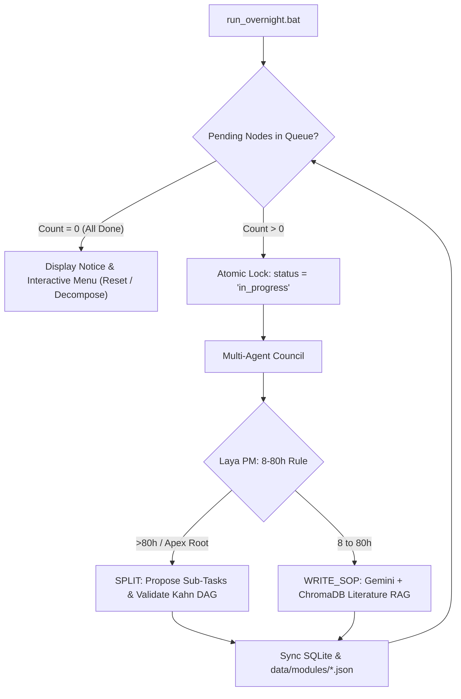

# Autonomous Crawler State Machine & Lifecycle Protocol

- **Date**: 2026-10-11
- **Source**: Agent
- **Status**: Implemented

## Overview & Rationale
The DRAM Foundation VN Autonomous Overnight Crawler (`workflow/crawler_engine.py`) operates as a self-terminating, resilient BFS state machine. 

A common operational point of confusion occurs when the crawler finishes with:
```text
All nodes across the DRAM WBS tree are complete! No pending nodes remaining.
Crawler run completed 0 iterations.
```
This is not a system failure or an execution refusal. It is the intended steady-state behavior under the **8–80 Hour WBS Rule**: when all existing work packages have either been decomposed into children or completed with quantitative, machine-measurable SOPs and literature citations, the queue of `pending` nodes becomes empty.

## Architecture & Lifecycle



## State Control Commands

The crawler engine supports command-line management for manual, automated, or overnight runs:

| Command | Action |
| :--- | :--- |
| `run_overnight.bat` | Starts crawler loop; displays interactive menu if 0 pending nodes exist. |
| `python workflow/crawler_engine.py --status` | Displays distribution of nodes (`total`, `done`, `pending`, `in_progress`, `red_flag`). |
| `python workflow/crawler_engine.py --target-nodes 1000 --max-depth 4` | Decomposes WBS tree recursively toward 1000 sub-problems down to depth 4. |
| `python workflow/crawler_engine.py --reset root` | Resets Apex Root and its children to `pending`. |
| `python workflow/crawler_engine.py --reset all` | Resets all nodes across all modules to `pending`. |
| `python workflow/crawler_engine.py --decompose <node_id>` | Forces decomposition of a specific node into sub-tasks. |
| `python workflow/crawler_engine.py --max-iterations <N>` | Runs bounded execution up to $N$ work packages. |

## Recursive Decomposition Architecture (Scaling to 1000+ Problems)

To transform the legacy 180nm DRAM chip project into 1000+ granular, measurable problems:
1. **Dynamic Gemini Decomposition**: The Domain Expert Agent queries ChromaDB literature and calls Gemini (`gemini-3.8-flash-low` / `gemini-2.5-flash`) to dynamically propose 3–5 sequential sub-tasks.
2. **Depth & Node Scaling Gate**:
   $$\text{scope} = \begin{cases} \text{spawn\_children}, & \text{if } N_{\text{total}} < N_{\text{target}} \land \text{depth} < D_{\text{max}} \land \text{action} \ne \text{"Buy"} \\ \text{write\_sop}, & \text{otherwise} \end{cases}$$
3. **Branching Explosion**:
   - Level 0 (Root): 1 Apex Node
   - Level 1 (Disciplines): 7 major domains
   - Level 2 (Functional Modules): ~35 modules
   - Level 3 (Unit Operations): ~140 operations
   - Level 4 (Work Packages): ~450 packages
   - Level 5 (Atomic SOPs): 1000+ verifiable tasks (8–16h effort each)


## References & Related Files
- [run_overnight.bat](../../run_overnight.bat)
- [workflow/crawler_engine.py](../../workflow/crawler_engine.py)
- [docs/context2.yaml](../context2.yaml)
- [docs/pipeline_demo.py](../pipeline_demo.py)
