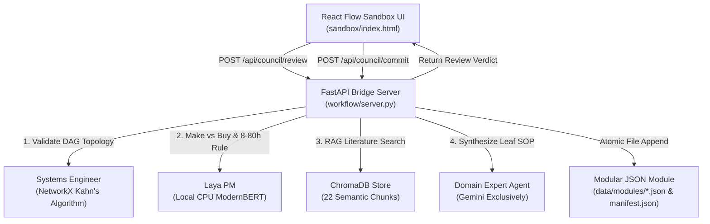

# FastAPI Bridge Server & AI Council Integration

- **Date**: 2026-10-08
- **Source**: Agent
- **Status**: Implemented

## Overview & Rationale
To bridge the interactive browser UI with the local AI Council (Systems Engineer, Laya ModernBERT Project Manager, and Gemini Domain Expert) and the ChromaDB semiconductor vector store, we implemented a lightweight, zero-token CPU-first FastAPI server (`workflow/server.py`). This architecture preserves the **Single Source of Truth (SSOT)**: modular JSON files on disk (`data/modules/*.json`) and `data/manifest.json`.

## Architecture & Data Flow

## Key Technical Components

### 1. Local FastAPI Bridge (`workflow/server.py`)
- **CORS Middleware**: Unrestricted localhost access for web sandbox.
- **REST Endpoints**:
  - `GET /api/status`: Real-time vector store chunk count, active nodes, active edges, registered modules.
  - `GET /api/graph`: Merged graph payload from all modular JSON files.
  - `GET /api/manifest` & `GET /api/modules`: Modular inventory inspection.
  - `POST /api/council/review`: Executes 4-stage Council vetting.
  - `POST /api/council/commit`: Appends approved work packages directly to target module JSON on disk and updates manifest node counts.
  - `POST /api/search`: Direct semantic similarity search across semiconductor literature.
  - `POST /api/crawl`: Ingestion of URLs, technical PDFs, and baseline seed literature.

### 2. Six Semiconductor Disciplines Modular Decomposition
The project models the complete vertical stack of legacy 180nm DRAM fabrication:
1. `01_mcu_cots.json`: Electronics & Drive Infrastructure (COTS Buy).
2. `02_litho_stage_gen1.json`: Macroscopic Lithography Linear Stage (Make ±0.1 mm).
3. `03_optical_aligner_gen2.json`: Microscopic Mask Optical Aligner (Make ±5 µm).
4. `04_wet_chemistry_gen1.json`: Acid Exhaust Fume Hood, RCA-1/2 Wafer Cleaning, BOE (6:1) Etching.
5. `05_thermal_oxidation_gen1.json`: Fused Quartz 3-Zone PID Furnace, Deal-Grove 3.5nm Gate Oxide, Pyrogenic Wet Field Isolation.
6. `06_dram_cell_architecture_gen2.json`: 180nm 1T1C Cell Layout (8F², 28 fF), Folded Bitline Sense Amplifier, VPP Address Decoders.

### 3. Frontend Semantic Zooming & Nested Graphs
- **Semantic Zooming**:
  - `Zoom < 75%` (Macro View): Compact badge cards showing node ID, action type (Make/Buy), and status.
  - `75% <= Zoom <= 135%` (Standard View): Full work package cards with primary target metrics and generation labels.
  - `Zoom > 135%` (Microscopic View): Deep-dive cards showing RAG citation counts and estimated effort hours.
- **Discipline Filter & Breadcrumb Navigation**:
  - Allows selecting individual modules to drill down into localized sub-graphs while preserving cross-module boundary edges.
  - One-click breadcrumb button to return to the full overview graph.
- **In-Browser "Convene AI Council" Modal**:
  - Users can propose a candidate node, select prerequisites and target modules, and run the live AI Council review directly in the browser with full verdict inspection before committing.

## References & Related Files
- [workflow/server.py](../../workflow/server.py)
- [workflow/council/orchestrator.py](../../workflow/council/orchestrator.py)
- [sandbox/index.html](../../sandbox/index.html)
- [sandbox/data-engine.js](../../sandbox/data-engine.js)
- [data/manifest.json](../../data/manifest.json)
- [tests/test_server_api.py](../../tests/test_server_api.py)
