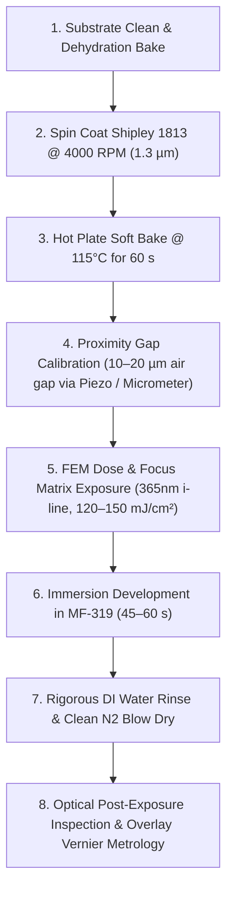

# Standard Operating Procedure (SOP)
## FEM Exposure Matrix Lithography & Gap Recipe Execution

- **Date**: 2026-10-12
- **Author**: Domain Expert AI (DRAM Foundation VN Multi-Agent Council)
- **Status**: Implemented / Ready for Execution
- **Discipline**: Wet Chemistry / Photolithography & Optics
- **Target Generation**: Gen 2 (µm-scale)
- **Process Hierarchy**: Context: 180nm Open-Source DRAM Chip > Microscopic Mask Optical Alignment > Post-Exposure Overlay Vernier Metrology & Alignment Verification > Vernier Test Pattern Layout & Exposure Matrix Calibration > FEM Exposure Matrix Lithography & Gap Recipe Execution

---

## 1. Process Overview & Objectives
This SOP outlines the execution protocol for Focus-Exposure Matrix (FEM) lithography and proximity gap calibration on silicon substrates for Gen 2 DRAM vernier test structures and micron-scale test patterns. It establishes standard spin-coating, soft bake, proximity gap positioning, UV dose matrix exposure, MF-319 development, and rinse dry steps.

---

## 2. Step-by-Step Operating Procedure

### Step 1: Substrate Preparation & Spin Coating
1. Mount the cleaned test silicon wafer onto the vacuum chuck of the spin coater.
2. Dispense positive photoresist **Shipley 1813** dynamically or statically at wafer center.
3. Spin-coat at **4000 RPM** to target an emulsion film thickness of **~1.3 µm**.

### Step 2: Soft Bake
1. Transfer wafer immediately to a calibrated, flat aluminum hot plate.
2. Soft bake at **115°C for 60 seconds** to drive off residual casting solvents and relieve internal resist stress.
3. Transfer wafer to a passive cooling heatsink block for 30 seconds before stage mounting.

### Step 3: Proximity Gap Setting & Leveling
1. Mount the quartz-chromium mask and resist-coated wafer into the optical mask aligner stage.
2. Set aligner to **Proximity Printing Mode** to avoid contact scratches on delicate mask features.
3. Adjust the air gap between mask and photoresist film to **10 to 20 µm** using three closed-loop piezo actuators or high-precision differential micrometers (sensitivity target: 0.1 µm).

### Step 4: FEM Exposure Calibration & Matrix Execution
1. Calibrate UV irradiance ($mW/cm^2$) across the optical field using an optical radiometer. Ensure beam uniformity is **>95%** using the fly's eye integrator lens.
2. Configure the 365nm (i-line) LED array or 200W Mercury short-arc lamp source.
3. Execute the Focus-Exposure Matrix (FEM) stepping recipe:
   - Dose range: **120 mJ/cm² to 150 mJ/cm²** (stepped across columns).
   - Proximity gap: **10 µm to 20 µm** (stepped across rows).

### Step 5: Development & Rinse
1. Immerse wafer into a static or mildly agitated bath of **Microposit MF-319 developer** for **45 to 60 seconds**.
2. Immediately quench the developer reaction by transferring into a cascade deionized (DI) water bath.
3. Rinse rigorously with DI water for $\ge 60$ seconds.
4. Dry thoroughly using filtered dry nitrogen ($N_2$) gas from center to edge.

### Step 6: Post-Development Inspection & Vernier Alignment Check
1. Inspect the developed vernier crosshair patterns under optical microscope (10x Plan Achromat, NA 0.25).
2. Measure alignment error across target fiducials, validating compliance within Gen 2 tolerance ($\pm 5\ \mu m$).

---

## 3. Machine-Measurable Acceptance Criteria Target Metrics

| Parameter / Metric | Target Value | Physical Units | Verification Method |
| :--- | :--- | :--- | :--- |
| **Resist Film Thickness** | **1.3 $\pm$ 0.05** | $\mu\text{m}$ | Optical reflectometry / profilometry after 4000 RPM coat |
| **Soft Bake Temperature** | **115 $\pm$ 2** | $^\circ\text{C}$ | Calibrated surface thermocouple (60 s dwell) |
| **Mask-to-Wafer Air Gap** | **10 to 20** (actuator sensitivity 0.1) | $\mu\text{m}$ | Differential micrometer / closed-loop piezo sensor |
| **UV Exposure Dose (i-line 365nm)** | **120 to 150** (beam uniformity >95%) | $\text{mJ/cm}^2$ | Calibrated optical radiometer |
| **MF-319 Development Dwell** | **45 to 60** | $\text{seconds}$ | Digital process countdown timer |
| **Gen 2 Alignment Overlay Tolerance** | **$\le \pm 5$** | $\mu\text{m}$ | Optical Vernier scale metrology |

---

## 4. Source Literature Citations
This procedure directly cites and strictly adheres to parameters from the following verified local references:
1. **Sam Zeloof Z1 Garage Semiconductor Journal (2018)**:
   - Shipley 1813 spin-coated at 4000 RPM yielding ~1.3 µm thickness.
   - Soft bake at 115°C for 60 seconds on flat aluminum hot plate.
   - High-power 365nm i-line source; Microposit MF-319 developer for 45–60 seconds followed by DI water rinse.
   - 10x Plan Achromat objective (NA 0.25); Gen 2 alignment tolerance of $\pm 5\ \mu m$.
2. **Optical Mask Aligner Mechanics: Gap Control and UV Exposure Dose**:
   - Proximity printing air gap of 10 to 20 µm to prevent contact damage; diffraction limits resolution to ~2-3 µm.
   - Gap setting via three differential micrometers or closed-loop piezo actuators with 0.1 µm sensitivity.
   - 365nm i-line source with fly's eye integrator lens yielding >95% beam uniformity.
   - Optimum clear dose window of 120–150 mJ/cm² for Shipley 1813 (1.3 µm thickness).
