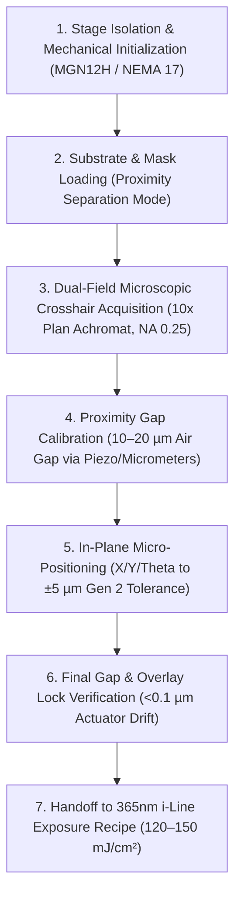

# Standard Operating Procedure (SOP)
## Fiducial Overlay Crosshair Micro-Positioning & Proximity Gap Calibration

- **Date**: 2026-10-13
- **Author**: Domain Expert AI (DRAM Foundation VN Multi-Agent Council)
- **Status**: Implemented / Ready for Execution
- **Discipline**: Optics & Precision Alignment / Photolithography
- **Target Generation**: Gen 2 (µm-scale)
- **Process Hierarchy**: Context: 180nm Open-Source DRAM Chip (DRAM Foundation VN) [Architecture & Integration] > Microscopic Mask Optical Alignment [Optics & Precision Alignment] > Fiducial Mark Crosshair Alignment & UV Exposure Recipe Execution [Photolithography] > Microscopic Crosshair Fiducial Overlay Alignment & i-Line Dose Recipe Execution [Photolithography] > Fiducial Overlay Crosshair Micro-Positioning & Proximity Gap Calibration [Optics & Precision Alignment]

---

## 1. Process Overview & Objectives
This Standard Operating Procedure defines the micro-positioning and proximity gap calibration sequence for aligning mask and wafer fiducial crosshairs prior to UV exposure in Gen 2 lithography. It specifies stage vibration dampening, split-field / dual-objective optical crosshair alignment, differential micrometer / piezo proximity gap leveling, and post-alignment verification.

---

## 2. Step-by-Step Operating Procedure

### Step 1: Environmental & Mechanical Initialization
1. Verify stage vibration isolation: ensure the macroscopic 4040 aluminum extrusion stage sits on neoprene dampers or sorbothane pads (isolating mechanical rumble $>30\text{ Hz}$).
2. Power on the NEMA 17 stepper motors (configured with 1/16 microstepping driving C7 rolled ball screws / anti-backlash lead screws).
3. Initialize home position along precision ground linear guide rails (MGN12H) and confirm optical/magnetic linear encoder feedback (1 µm resolution). Confirm guide rail straightness $<5\text{ µm} / 100\text{ mm}$.

### Step 2: Substrate & Mask Loading
1. Load the Shipley 1813 resist-coated wafer (spin-coated at 4000 RPM to ~1.3 µm, soft-baked at 115°C for 60 s) onto the vacuum chuck.
2. Mount the chromium-on-quartz mask into the upper mask holder with emulsion facing downward toward the wafer.
3. Maintain an initial safety clearance ($>100\text{ µm}$) during mechanical loading to prevent contact scratch defects.

### Step 3: Optical Crosshair Acquisition
1. Position optical microscope assembly equipped with 10x Plan Achromat objectives (NA 0.25) over mask and wafer fiducial crosshairs.
2. Illuminate with yellow or non-actinic long-wavelength alignment light to prevent premature resist exposure.
3. Coarse-align the substrate stage to bring wafer fiducials within the field of view of the mask crosshairs.

### Step 4: Proximity Gap Leveling & Setting
1. Lower the mask towards the wafer using three high-precision differential micrometers or closed-loop piezo actuators with 0.1 µm sensitivity.
2. Establish parallelism across the wafer surface and set the working proximity air gap to **10 µm to 20 µm**.
3. Confirm proximity gap setting via optical micrometer / capacitance sensor / fringe metrology, ensuring no physical mask-resist contact.

### Step 5: Micro-Positioning & In-Plane Overlay Alignment
1. In fine alignment mode, actuate X, Y, and $\theta$ (rotation) micro-positioning controls while observing fiducial crosshairs under 10x Plan Achromat optics.
2. Center the mask crosshairs over wafer fiducials, eliminating translational and rotational offset.
3. Adjust until in-plane overlay alignment error is within **$\pm 5\text{ µm}$** (Gen 2 target specification).

### Step 6: Alignment Lock & Readiness Verification
1. Lock stage positioning locks / brake actuators and observe fiducial overlay for 10 seconds to confirm no mechanical slip or creep drift.
2. Re-verify the proximity gap remains within **10–20 µm** and beam alignment/uniformity is ready for i-line UV exposure ($120\text{--}150\text{ mJ/cm}^2$ clear dose).

---

## 3. Machine-Measurable Acceptance Criteria

| Parameter / Metric | Target Value | Physical Units | Verification Tool / Method |
| :--- | :--- | :--- | :--- |
| **In-Plane Overlay Alignment Tolerance** | $\le \pm 5.0$ | $\mu\text{m}$ | Optical microscope (10x Plan Achromat, NA 0.25) crosshair overlay metrology |
| **Proximity Air Gap** | $10 \text{ to } 20$ | $\mu\text{m}$ | Closed-loop piezo actuators / differential micrometers (0.1 µm sensitivity) |
| **Stage Travel Straightness** | $< 5$ | $\mu\text{m} / 100\text{ mm}$ | MGN12H linear guide rail calibration / optical encoder |
| **Vibration Isolation Cutoff** | $> 30$ | $\text{Hz}$ | Sorbothane / neoprene damping pad dynamic vibration attenuation |

---

## 4. Literature References & Citations

1. **Sam Zeloof Z1 Garage Semiconductor Journal (2018)**:
   - Microscope optics: 10x Plan Achromat (NA 0.25) for micron-scale feature resolution.
   - Resist parameters: Shipley 1813 @ 4000 RPM (~1.3 µm thickness), soft bake 115°C for 60 s.
   - Alignment tolerance: Gen 1 $\pm 100\text{ µm}$ ($0.1\text{ mm}$), Gen 2 $\pm 5\text{ µm}$.
2. **Optical Mask Aligner Mechanics: Gap Control and UV Exposure Dose**:
   - Proximity Printing Mode: 10 to 20 µm air gap eliminating contact scratches; diffraction limits resolution to ~2-3 µm.
   - Gap setting mechanics: Three high-precision differential micrometers or closed-loop piezo actuators with 0.1 µm sensitivity.
   - Exposure source & dose: 365nm (i-line) LED array or 200W Hg lamp, fly's eye integrator ($>95\%$ uniformity), $120\text{--}150\text{ mJ/cm}^2$ optimum clear dose for Shipley 1813.
3. **Precision Linear Stage Design & Vibration Damping**:
   - Mechanical frame & rails: Extruded aluminum 4040 frames with MGN12H precision linear guide rails straightness $<5\text{ µm} / 100\text{ mm}$.
   - Drive mechanics: C7 rolled ball screws / anti-backlash lead screws with NEMA 17 stepper motors (1/16 microstepping).
   - Vibration damping: Neoprene dampers or sorbothane pads isolating external vibrations above 30 Hz; optical encoder / linear magnetic scales (1 µm resolution).
