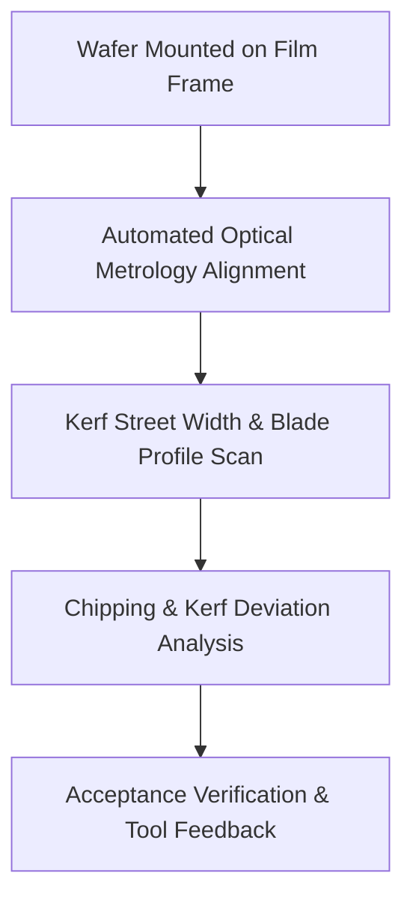

# Standard Operating Procedure (SOP)
## Kerf Street Width & Blade Wear Profile Metrology Measurement

- **Module**: Packaging & Assembly / Post-Dicing Metrology Inspection
- **Process Node**: 180nm Open-Source DRAM Chip (DRAM Foundation VN) / Gen 3
- **Action Type**: Buy (Commercial Metrology Station / Inspection Service)
- **Status**: Implemented

---

### 1. Process Overview & Objective
This SOP defines the automated optical metrology procedure to inspect post-saw kerf street dimensions, edge chipping, and diamond blade wear profiles on diced 180nm DRAM wafers mounted on dicing tape and film frames.

---

### 2. Step-by-Step Procedure

1. **Wafer Frame Loading & Coordinate Registration**:
   - Secure the dicing tape frame onto the motorized vacuum stage of the optical inspection station.
   - Set stage step motion matching the foundry physical placement manufacturing grid resolution of **0.005 µm (5 nm)**.
   - Perform coarse and fine fiducial optical alignment across street intersections to establish die coordinate origin within **±5 µm**.

2. **Optical Calibration & Illumination Setup**:
   - Engage high-resolution Plan Achromat objective (0.25 NA) with calibrated top-down brightfield illumination.
   - Calibrate the optical system pixel-to-micron scale against a certified chrome-on-quartz calibration reticle to ensure dimensional measurement uncertainty < 0.05 µm.

3. **Multi-Point Automated Kerf Scanning (Wafer Mapping)**:
   - Execute an automated wafer-level mapping routine (sampling 9-point or 49-point grid locations across center, mid-radius, and edge exclusion zones).
   - Capture high-resolution digital micrographs across both orthogonal dicing axes (X-street and Y-street).

4. **Kerf Width & Blade Wear Profile Extraction**:
   - Run automated edge-detection algorithms across the cut channel:
     - Measure cut width ($W_{\text{kerf}}$) along each street segment.
     - Quantify cut-centerline lateral offset relative to the drawn kerf design street centerline.
     - Extract blade kerf profile expansion: calculate wear rate $\Delta W = W_{\text{measured}} - W_{\text{nominal\_blade}}$.
   - Detect topside micro-chipping depth and lateral protrusion into the die active seal ring exclusion zones.

5. **Pass/Fail Disposition & Dicing Saw Closed-Loop Feedback**:
   - Compare extracted metrics against acceptance criteria.
   - If $\Delta W$ or kerf center offset exceeds warning thresholds (±5 µm), log blade wear and trigger saw dressing or blade replacement alert.

---

### 3. Machine-Measurable Acceptance Criteria Target Metrics

| Parameter | Measurement Target Metric | Tolerance / Upper Spec Limit (USL) | Physical Units |
| :--- | :--- | :--- | :--- |
| **Kerf Street Placement Grid** | Coordinate positioning resolution | $0.005$ | $\mu\text{m}$ ($5\text{ nm}$) |
| **Street Alignment Tolerance** | Alignment registration accuracy | $\le \pm 5$ | $\mu\text{m}$ |
| **Kerf Width Centerline Deviation** | Cut street centerline drift from nominal | $\le \pm 5$ | $\mu\text{m}$ |
| **Topside Chipping Maximum Extension** | Maximum lateral chip intrusion beyond kerf wall | $\le 5$ | $\mu\text{m}$ |

---

### 4. Verified Literature Citations
- **SkyWater SKY130 Open PDK Design Rules & Lithography Grid**: Physical placement grid resolution of $0.005\ \mu\text{m}$ ($5\text{ nm}$).
- **Spectroscopic Ellipsometry and Reflectometry for Dielectric Film Metrology**: Standard 9-point or 49-point automated wafer mapping methodology.
- **Sam Zeloof Z1 Garage Semiconductor Journal (2018)**: High-resolution optical microscopy alignment baseline ($\pm 5\ \mu\text{m}$) using Plan Achromat optics ($0.25\text{ NA}$).
