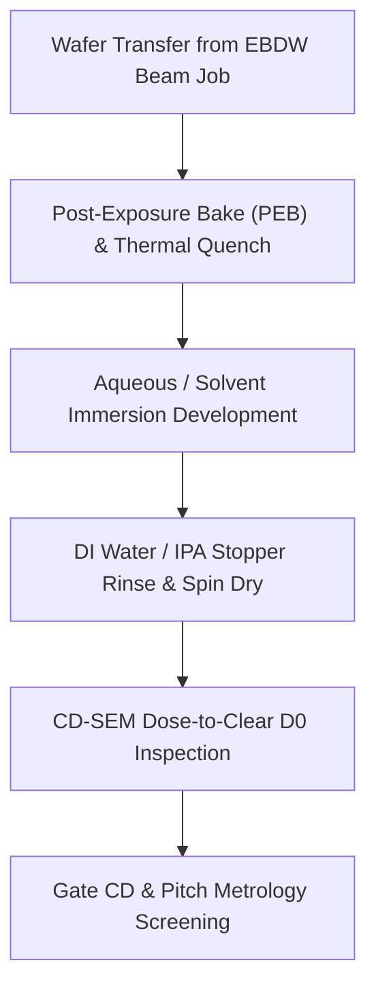

# SOP: Post-Exposure Bake, Development & CD-SEM Dose-to-Clear Metrology Screening

- **Date**: 2026-10-15
- **Source**: Domain Expert AI (DRAM Foundation VN Multi-Agent Council)
- **Status**: Accepted
- **Generation**: Gen 3 (nm)
- **Action Type**: Buy (Commercial Outsourced Foundry / Metrology Services & COTS Photolithography Chemistry)

---

## 1. Process Overview & Objective
This Standard Operating Procedure (SOP) defines the operational recipe and metrology verification sequence for post-exposure thermal stabilization, wet chemical development, and Critical Dimension Scanning Electron Microscopy (CD-SEM) dose-to-clear ($D_0$) screening. The process targets the definition of 180nm critical dimension gates for open-source DRAM access transistors and SkyWater SKY130-compatible lithography layers exposed via Electron Beam Direct Write (EBDW) and DUV/i-line benchmark matrices.

---

## 2. Step-by-Step SOP Procedure

### Step 1: Post-Exposure Transfer & PEB Thermal Processing
1. Unload the exposed dose-matrix wafer from the vacuum chamber of the EBDW tool (or DUV/i-line exposure tool).
2. For chemically amplified resists / high-resolution electron-beam resists, immediately transfer the substrate to a precision vacuum-chuckle hotplate:
   - Temperature setpoint: **115°C** (calibrated against optical and thermal baseline standards).
   - Dwell duration: **60 seconds** on a flat vacuum chuck.
   - Temperature uniformity across the wafer surface: $\le \pm 0.5^\circ\text{C}$.
3. Transfer immediately to a thermal chill plate at **21.0°C** for 30 seconds to quench thermal reaction kinetics and freeze proximity-effect acid diffusion.

### Step 2: Immersion Development & Quenching
1. Prepare the wet development bench with fresh filtered developer:
   - Primary Developer: **Microposit MF-319** (aqueous tetramethylammonium hydroxide [TMAH] formulation) for positive resists, or COTS developer chemistry for ZEP520A/HSQ matrices.
   - Bath temperature: **21.0°C $\pm$ 0.5°C**.
2. Mount the substrate into a PTFE wafer cassette and lower it into the developer bath with gentle, continuous megasonic/reciprocating agitation.
3. Development duration: **45 to 60 seconds**.
4. Quench development immediately by submerging the cassette into an overflowing Deionized (DI) Water cascade tank (resistivity $\ge 18.2\ \text{M}\Omega\cdot\text{cm}$) for **60 seconds**, followed by a quick-dump rinse (QDR) cycle.
5. High-purity dry nitrogen ($\text{N}_2$) surface blowout at 40 psi combined with spin drying at **3000–4000 RPM** for 30 seconds until the wafer is completely hydrophobic and dry.

### Step 3: CD-SEM Dose-to-Clear ($D_0$) Screening & Metrology
1. Load the dry wafer into the automated load-lock chamber of the inline Metrology CD-SEM. Pump down to high-vacuum operating pressure ($\le 1.0 \times 10^{-6}\ \text{Torr}$).
2. Align to global wafer alignment marks and navigate to the Dose-Array Matrix test fields.
3. Optical / Low-magnification electron inspection:
   - Identify the unpatterned clearing field rows to locate $D_0$ (the threshold exposure dose in $\mu\text{C/cm}^2$ or $\text{mJ/cm}^2$ at which the resist completely dissolves to the substrate interface without residual scumming).
4. High-magnification ($150{,}000\times$) CD Metrology Scan:
   - Set acceleration voltage $V_{\text{acc}} = 500\ \text{V} - 800\ \text{V}$ with low beam current ($I_{\text{beam}} \le 8\ \text{pA}$) to prevent resist shrinkage during measurement.
   - Capture edge-detection intensity profiles across the DRAM access transistor poly gates: nominal drawn channel length target **180 nm** (and minimum SkyWater poly gate length **150 nm**).
   - Measure gate-to-gate spacing pitch (nominal target $\ge \mathbf{210\ nm}$ per SkyWater rules).
   - Evaluate active diffusion width alignment against the **150 nm** minimum rule and verify overlay error relative to underlying active diffusion ($\le \mathbf{35\ nm}$).

---

## 3. Acceptance Criteria Metrics

| Parameter / Metric | Target Value | Physical Unit | Verification Method | Tolerance / Rule Source |
| :--- | :--- | :--- | :--- | :--- |
| **DRAM Access Transistor Channel Length ($L$)** | **180** | nm | Top-down CD-SEM | $\pm 5\ \text{nm}$ (180nm DRAM Cell Layout Topology) |
| **Minimum Poly Gate Spacing Pitch** | $\ge$ **210** | nm | CD-SEM Line-Space Profiler | SkyWater SKY130 Open PDK Rule |
| **Active Diffusion Minimum Width** | $\ge$ **150** | nm | Top-down CD-SEM | SkyWater SKY130 Open PDK Rule |
| **Gate Poly to Active Diffusion Overlay Error** | $\le$ **35** | nm | In-die Box-in-Box / Frame Metrology | SkyWater SKY130 Open PDK Rule |
| **PEB Hotplate Temperature & Duration** | **115 / 60** | °C / s | Thermal surface sensor / Timer | $\pm 0.5^\circ\text{C}$ (Sam Zeloof Journal Reference) |
| **Wet Development Time (MF-319)** | **45 – 60** | s | Automatic timer | Complete clear / Zero scumming ($D_0$) |

---

## 4. Context Citations
1. **180nm DRAM Cell Layout Topology: Stacked Capacitor vs Deep Trench**:
   - Access transistor channel length: $L = 180\ \text{nm}$, channel width $W = 220\ \text{nm}$.
   - DRAM stacked capacitor architecture integration and 1 fA/cell leakage target budget.
2. **Sam Zeloof Z1 Garage Semiconductor Journal (2018)**:
   - Soft/post-bake thermal profile: $115^\circ\text{C}$ for 60 seconds on a flat aluminum/vacuum hot plate.
   - Developer bath parameters: Microposit MF-319 for 45–60 seconds, followed by rigorous DI water cascade rinsing.
3. **SkyWater SKY130 Open PDK Design Rules & Lithography Grid**:
   - Manufacturing grid resolution: $0.005\ \mu\text{m}$ ($5\ \text{nm}$).
   - Minimum active diffusion width: $0.15\ \mu\text{m}$ ($150\ \text{nm}$).
   - Minimum poly gate length: $0.15\ \mu\text{m}$ ($150\ \text{nm}$); minimum poly gate spacing: $0.21\ \mu\text{m}$ ($210\ \text{nm}$).
   - Overlay error budget between gate poly and active diffusion: $\le 35\ \text{nm}$.
