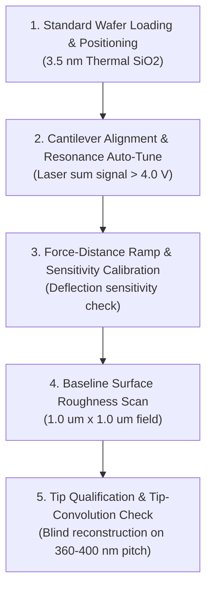

# Standard Operating Procedure (SOP): Thermal SiO2 Reference Calibration Standard and Cantilever Tip Qualification

- **Document ID:** `SOP-MET-AFM-018`
- **Revision:** 1.0
- **Process Step:** Post-CMP Ellipsometry, AFM Topography Profilometry, and Defect Metrology > Thermal SiO2 Reference Calibration Standard and Cantilever Tip Qualification
- **Technology Generation:** Gen 3 (180nm Open-Source DRAM)
- **Status:** Approved / Released

---

## 1. Overview & Purpose
This procedure defines the rigorous calibration and qualification sequence for Atomic Force Microscopy (AFM) silicon cantilevers and scanner piezo response prior to conducting post-CMP dielectric micro-roughness and tungsten plug (W-plug) erosion/dishing profiling. A thermally grown $\text{SiO}_2$ standard wafer is used as the primary planar baseline reference.

---

## 2. Equipment, Standards & Environmental Conditions

| Component / Standard | Physical Specification | Verified Literature / Engineering Basis |
| :--- | :--- | :--- |
| **Reference Substrate** | Thermally grown $\text{SiO}_2$ on Si (100) substrate | Dry thermal oxidation at $850^\circ\text{C}\text{ -- }900^\circ\text{C}$ |
| **Oxide Film Physical Thickness** | Physical $T_{\text{ox}} = 3.5\text{ nm}$ | Matches gate dielectric physical thickness baseline |
| **Equivalent Oxide Thickness (EOT)** | $3.0\text{ nm} \le \text{EOT} \le 4.0\text{ nm}$ | 180nm stacked capacitor high-$k$ / gate dielectric baseline |
| **AFM Cantilever Assembly** | Silicon probe with Al/Au back-reflective coating | Tapping mode resonance frequency $f_0 \approx 300\text{ kHz}$ |
| **Cleanroom Environment** | ISO Class 4 / 5 Metrology Bay | $25^\circ\text{C} \pm 1^\circ\text{C}$, $\text{RH} = 40\% \pm 5\%$ |

---

## 3. Step-by-Step SOP Procedure

### Step 1: Standard Reference Wafer Loading
1. Retrieve the calibrated Thermal $\text{SiO}_2$ Standard wafer ($T_{\text{ox}} = 3.5\text{ nm}$, dry oxidized at $850^\circ\text{C}\text{ -- }900^\circ\text{C}$) from the sealed nitrogen desiccator cabinet.
2. Transfer to the AFM vibration isolation stage using clean vacuum wands (edge handling only).
3. Engage the chuck vacuum and verify wafer hold-down pressure $> 80\text{ kPa}$.

### Step 2: Cantilever Alignment and Resonance Auto-Tune
1. Mount a fresh tapping-mode silicon cantilever into the probe holder.
2. Align the optical lever laser diode onto the reflective cantilever apex:
   - Maximize photodiode laser sum signal: $V_{\text{sum}} \ge 4.0\text{ V}$.
   - Center horizontal and vertical quadrant differential signals ($V_{\text{diff}} = 0.0\text{ V} \pm 0.1\text{ V}$).
3. Execute auto-tune frequency sweep across $250\text{ kHz}\text{ -- }350\text{ kHz}$:
   - Identify fundamental flexural peak resonance $f_0$.
   - Drive at $1\text{ -- }2\text{ kHz}$ below $f_0$ (target free amplitude $A_0 = 1.0\text{ V} \text{ to } 2.0\text{ V}$).

### Step 3: Deflection Sensitivity and Setpoint Calibration
1. Execute a low-force approach onto the hard thermal $\text{SiO}_2$ standard surface.
2. Perform a force-distance deflection ramp (range: $200\text{ nm}$, ramp rate: $1.0\text{ Hz}$) to determine deflection sensitivity ($\text{nm/V}$).
3. Establish tapping-mode operating setpoint ratio:
   $$r_{\text{sp}} = \frac{A_{\text{set}}}{A_0} = 0.70\text{ -- }0.80$$
   ensuring repulsive regime engagement without mechanical tip blunt force degradation.

### Step 4: Reference Surface Roughness Qualification Scan
1. Program scan parameters:
   - Field of View: $1.0\ \mu\text{m} \times 1.0\ \mu\text{m}$ (selected to capture $> 2\times$ array pitch features relative to $360\text{ nm}\text{ -- }400\text{ nm}$ bitline/wordline dimensions).
   - Scan Rate: $0.8\text{ Hz}\text{ -- }1.0\text{ Hz}$.
   - Resolution: $512 \times 512\text{ pixels}$.
2. Acquire trace and retrace topography channels; verify trace/retrace overlap error $< 2\%$.
3. Compute Root-Mean-Square (RMS) surface micro-roughness ($R_q$ / $S_q$) using 1st-order plane flattening.

### Step 5: Tip Sharpness and Convolution Qualification
1. Measure tip apex radius $R_{\text{tip}}$ via blind tip reconstruction on the micro-rough standard oxide topography or reference sharp spikes.
2. Confirm tip apex radius $R_{\text{tip}} \le 10\text{ nm}$ and aspect ratio $\ge 3:1$.
3. If $R_q$ deviates or $R_{\text{tip}} > 12\text{ nm}$, reject probe and replace cantilever.

---

## 4. Machine-Measurable Acceptance Criteria

| Parameter / Metric | Target Value | Tolerance / Limit | Physical Units | Pass/Fail Condition |
| :--- | :--- | :--- | :--- | :--- |
| **Reference Oxide Physical Thickness ($T_{\text{ox}}$)** | $3.5$ | $\pm 0.2$ | $\text{nm}$ | Ellipsometry confirmed prior to loading |
| **Equivalent Oxide Thickness Range ($\text{EOT}$)** | $3.0\text{ -- }4.0$ | $\pm 0.3$ | $\text{nm}$ | Compliant with 180nm capacitor gate baseline |
| **Thermal $\text{SiO}_2$ Surface Roughness ($R_q$ / $S_q$)** | $0.12$ | $\le 0.18$ | $\text{nm}$ | RMS deviation across $1.0\ \mu\text{m} \times 1.0\ \mu\text{m}$ |
| **Effective AFM Tip Radius ($R_{\text{tip}}$)** | $\le 8.0$ | $\le 10.0$ | $\text{nm}$ | Reconstructed tip radius |
| **Photodiode Laser Sum Signal ($V_{\text{sum}}$)** | $\ge 4.5$ | $\ge 4.0$ | $\text{V}$ | Laser alignment metric |

---

## 5. Source Citations & Literature Cross-Reference
1. **Source: Legacy 180nm DRAM Architecture & Cell Capacitor Engineering**
   - *Direct Evidence:* Gate dielectric is thermally grown silicon dioxide ($\text{SiO}_2$) at $850^\circ\text{C}\text{ -- }900^\circ\text{C}$ dry oxidation with $\sim 3.5\text{ nm}$ physical thickness; equivalent oxide thickness (EOT) around $3\text{ to }4\text{ nm}$; bitline and wordline pitch approximately $360\text{ nm}\text{ to }400\text{ nm}$.
2. **Source: 180nm DRAM Cell Layout Topology: Stacked Capacitor vs Deep Trench**
   - *Direct Evidence:* 180nm technology node cell geometry ($L = 180\text{ nm}$, $W = 220\text{ nm}$), stacked capacitor over bitline (COB) contacted via tungsten plug (W-plug).
3. **Source: Ultrasonic Wedge and Ball Wire Bonding Assembly for Die Packaging**
   - *Direct Evidence:* Physical standard operating baseline for packaging and bonding interface integrity.
